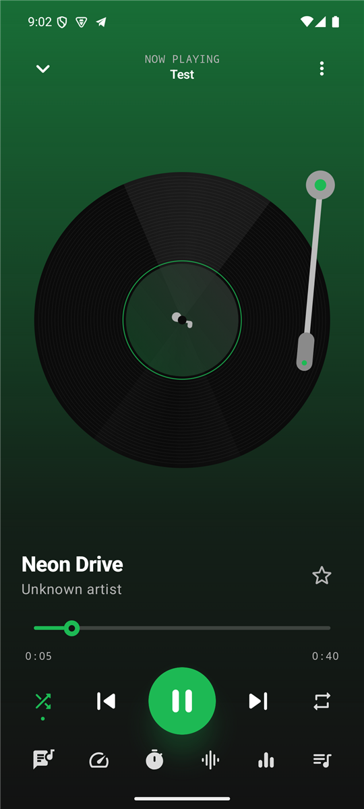
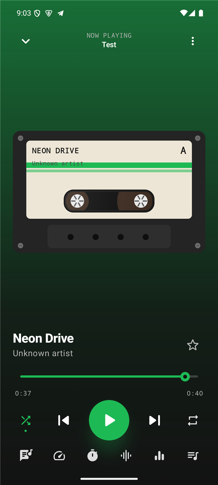
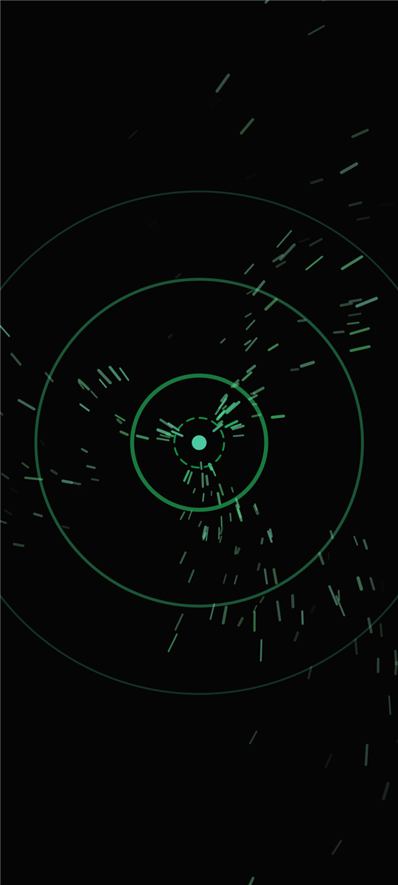
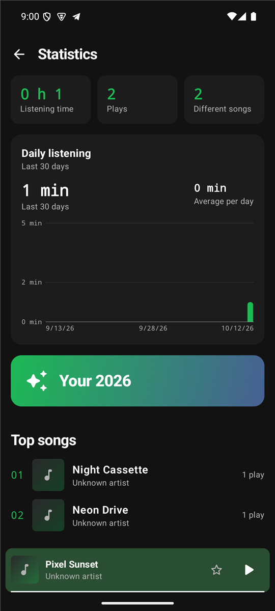

# Advanced Player

A free, offline music and video player for Android. No ads, no tracking, no account.
The app does not even ask for internet access.

<p align="center">
  
  
  
  
</p>

## Features

- MP3, AAC, FLAC, OGG, WAV and video (MP4, MKV, WebM), playing in the background with lock-screen controls
- Library from the whole phone, chosen folders or single files, with editable tags and custom artwork
- Playlists, favourites, smart playlists, shuffle, repeat, crossfade and gapless playback
- 10-band equalizer, bass boost, speed and pitch, sleep timer, A-B loop and bookmarks
- Visualizers (bars, circle, wave, mirror, particles, VU meter) and synced lyrics (`.lrc`)
- Dark, light or system theme, accent colours, vinyl and cassette player styles
- Listening statistics with a daily chart, home screen widget and car mode
- English (default), Czech and Slovak

## Download on your phone

1. Open the **Releases** page on your phone: https://github.com/OpiKula2877/Advanced-Player/releases
2. Tap the newest `AdvancedPlayer-x.y.z.apk`.
3. When Android asks, allow installing apps from this source.
4. Open the downloaded file and tap **Install**.

Requires Android 8.0 or newer.

## Build from source

Requires JDK 17 and the Android SDK (or Android Studio).

```bash
./gradlew assembleRelease
```

The APK is written to `app/build/outputs/apk/release/`.

## Status

Version 1.2.1. It is an early release, so expect rough edges. Bug reports and ideas are welcome in the Issues tab.
